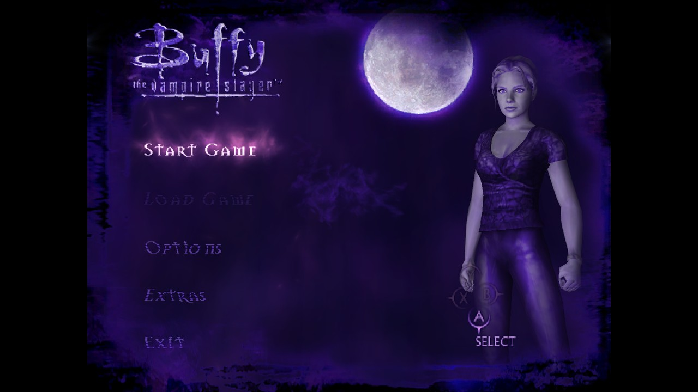
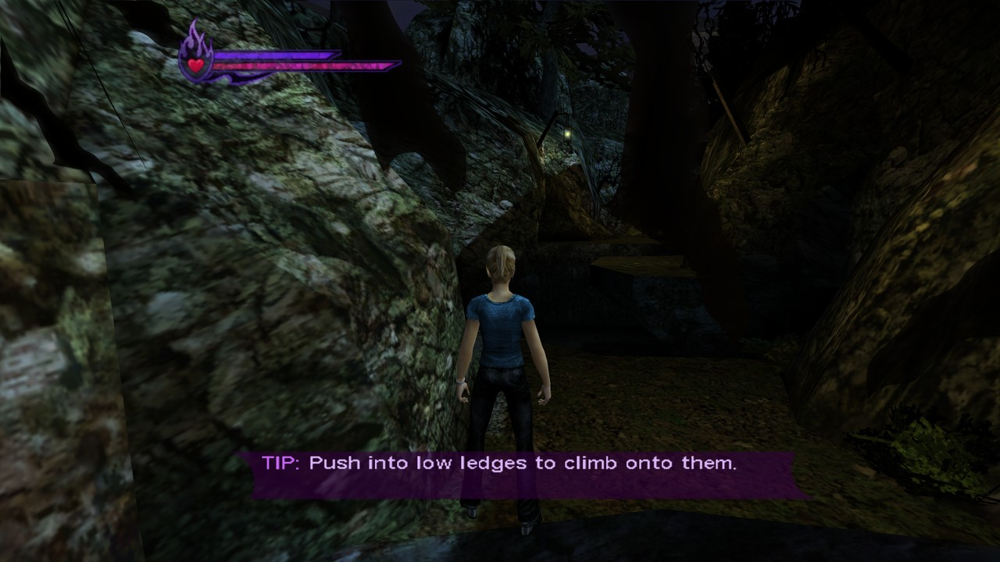
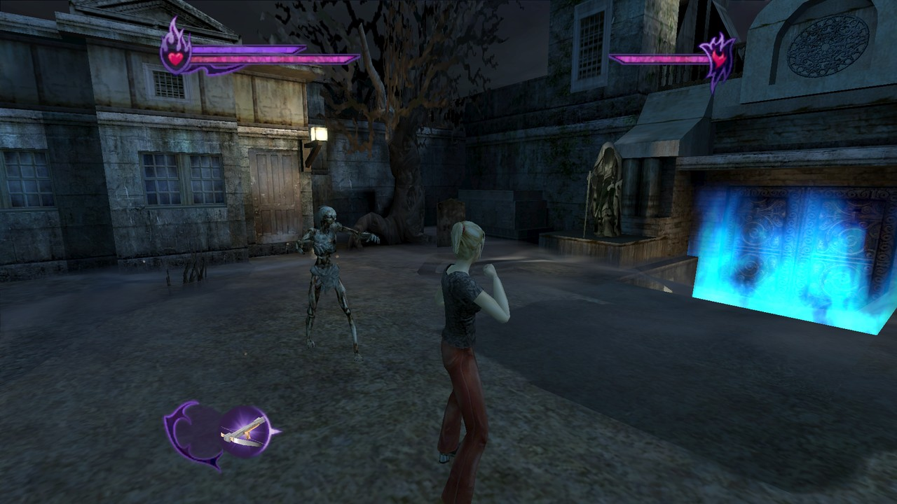
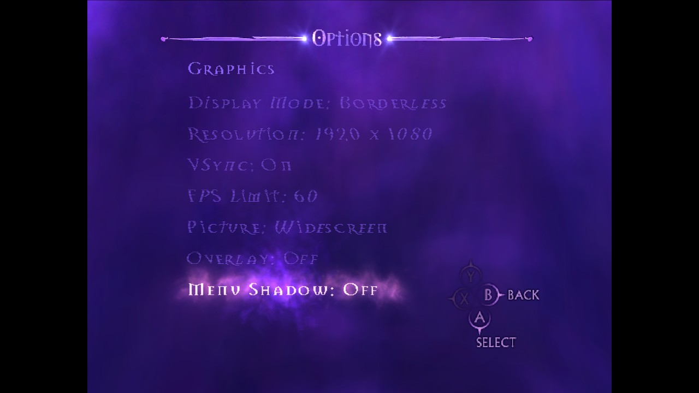
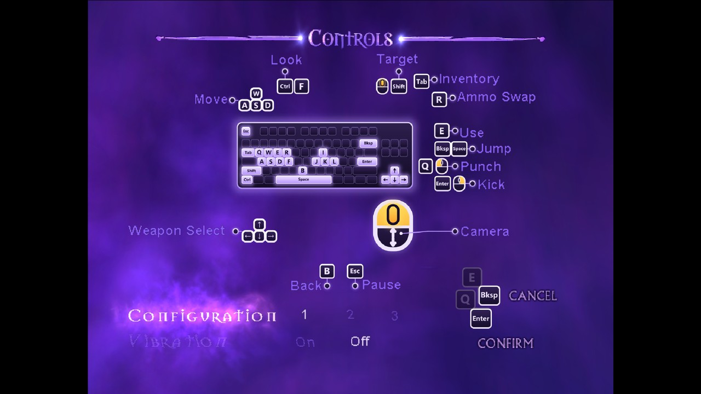
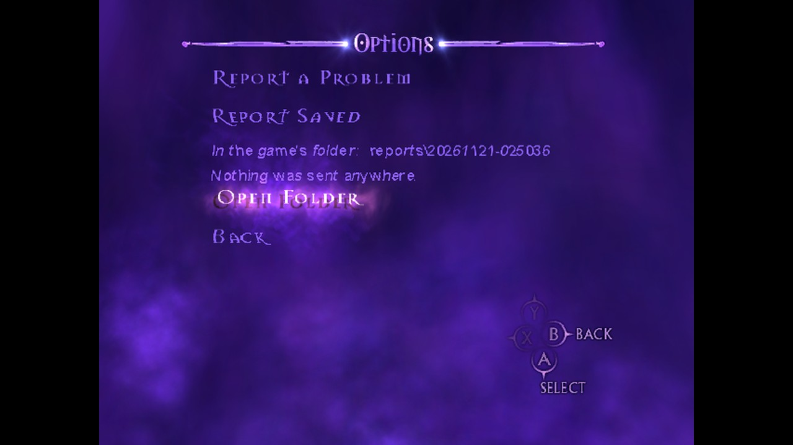
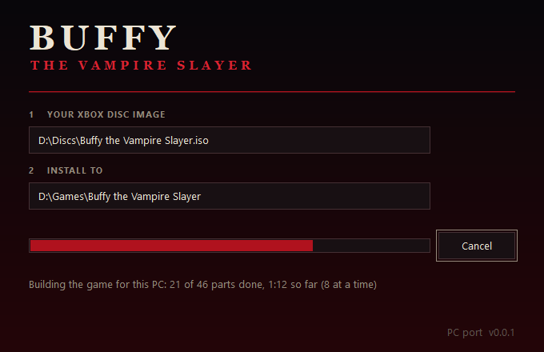

<h1 align="center">Buffy the Vampire Slayer — PC Port</h1>

  The 2002 Xbox game, running natively on Windows. Not an emulator. 
  <b>By KaikoClanworth</b>

  

> [!IMPORTANT]
> **There is no game in this repository.** You need your **own copy** of *Buffy the Vampire Slayer* for the original Xbox, as a disc image. The launcher builds the PC version from it, on your PC.

> [!WARNING]
> **Work in progress.** The game starts and levels can be played, but the port isn't finished and no level has been played through to its end yet. This is an early release: expect faults, and please report them.

---

## Pictures

<table>
  <tr>
    <td width="50%"> <b>In a level</b>, in widescreen</td>
    <td width="50%"> <b>A fight</b></td>
  </tr>
  <tr>
    <td> <b>Options → Graphics</b>, new in the game's own menu</td>
    <td> <b>Controls</b>, with keyboard and mouse pictures</td>
  </tr>
  <tr>
    <td> <b>Report a Problem</b>: saved on your PC, sent nowhere</td>
    <td></td>
  </tr>
</table>

All pictures are of this port running, taken by the game itself in test runs.

---

## What works today

- ✅ **The game starts and plays**: logos, intro movie, menus and levels. The first levels (the Spanish mission, the high school, the Bronze) have been played on a real screen. No level has been played through to its end yet.
- ✅ **Sharper picture**: any resolution up to 4K, drawn natively through Direct3D 11. Windowed, borderless or fullscreen.
- ✅ **Widescreen**: a wider view in the levels. The menus, the on-screen display and the movies keep their 4:3 shape, with black sides.
- ✅ **High frame rates**: 60 fps and above, with a limit you choose (30 to 240, or none).
- ✅ **Sound** through XAudio2: music, effects, speech and movie sound, each with its own volume.
- ✅ **Controllers, keyboard and mouse**: Xbox pads, and PlayStation and Switch pads through SDL. Keys and buttons can be changed in the game, and the button pictures follow the device you use.
- ✅ **PC options in the game's own menu**: *Options → Graphics*, *PC Audio*, *PC Controls* and *Memory*, and *Exit* on the main menu.
- ✅ **Report a Problem**: in *Options*, in the pause menu, or with **F12**. It saves a report that records what you did, so the same spot can be found again.
- ✅ **A launcher that installs the game** from your own disc image and builds it on your PC. No other tools are needed.

**Not there yet:** support for discs other than the European (PAL) one. Most of the port has been checked by automated runs with the window hidden and the sound off; much less has been seen, heard and played by hand, and nothing has been tried on a second PC. Known faults include levels that look dark until you raise the game's own brightness setting, and some objects that jump about. The full list is in [docs/STATUS.md](docs/STATUS.md).

---

## How to install

**You need**

- Your own *Buffy the Vampire Slayer* (2002) **Xbox** game as a disc image (`.iso` / xiso). Only the **European (PAL) release** is supported for now; the launcher checks your image and tells you if it's another release or another game.
- Windows 10 or 11 (64-bit) and a graphics card with Direct3D 11.
- About **2.4 GB** of free space for the game, and about 1 GB more while it is being built.

**Steps**

1. **Download** the latest `Buffy-the-Vampire-Slayer-PC-…-Windows-x64.zip` from [Releases](../../releases/latest) and unzip it anywhere.
2. **Open `Buffy Launcher.exe`** and choose your disc image and where to install the game.
3. Press **Install**. The launcher copies the game's files from your image, translates the game to PC code, compiles it and prepares the shaders. This takes about 8 to 10 minutes on the developer's PC, once.
4. Press **Play**.

   
  The launcher while it builds the game

**No build tools to install.** The game is built on your PC, and the compiler it needs comes inside the download.

**Updates.** The launcher looks for a newer release when it opens and offers **Update…**; it asks before it downloads anything, and your saves and settings are kept. (Until a second release exists this has only been tried against a stand-in on the developer's PC.)

Your disc image is only read, never changed. Your saves are kept in `XboxData\HardDisk` inside the game folder and your settings in `btvs_settings.ini`. Installing again leaves both alone. To uninstall, delete the game folder: nothing is written anywhere else on your PC.

---

## Keys

An Xbox controller works as on the console; on other pads the buttons are in the same places. Every key and button can be changed in **Options → PC Controls**.

| Xbox pad | What it does | Keyboard / mouse |
|---|---|---|
| **A** | Kick | Right mouse button, Enter |
| **B** | Jump | Space, Backspace |
| **X** | Punch | Left mouse button, Q |
| **Y** | Use | E |
| **Black** / **White** (the bumpers) | Ammo swap / inventory | R / Tab |
| **Left trigger** | Look and aim | Left Ctrl, F |
| **Right trigger** | Target | Left Shift, middle mouse button |
| **Start** | Pause, skip a cut-scene | Escape |
| **D-pad** | Choose a weapon | Arrow keys |
| **Left stick** / **Right stick** | Move / camera | W A S D / the mouse, I J K L |

The port adds these keys:

| Key | What it does |
|---|---|
| **F11**, or **Alt+Enter** | Fullscreen on / off |
| **F12**, or a click of the left stick | Make a problem report |

Picture, sound and control settings are in the game: **Options**. To leave the game: main menu → **Exit**.

---

## Something wrong?

1. In the game, choose **Options → Report a Problem** (it is in the pause menu too), or press **F12**.
2. Open an [issue](../../issues/new/choose) and attach the files the form asks for, from the new folder in `reports` inside the game folder.

Please don't attach the report's `.zip` or its `save` folder: they hold your saved games and other data of the game. Nothing is sent anywhere by the game itself.

---

## More

- [State of the port](docs/STATUS.md): what works, what doesn't, what has been checked and how.
- [Building from source](docs/BUILDING.md): for developers.
- Notes per area: [graphics](docs/graphics.md), [audio](docs/audio.md), [controls](docs/controls.md), [menus](docs/menu.md), [reports and logs](docs/logs.md), [install](docs/install.md).

## Credits

- **KaikoClanworth**: project lead, direction and testing.
- **[Claude Code](https://claude.com/claude-code)** (Anthropic's AI coding assistant) wrote most of the port's code, tools and docs.
- **[xboxrecomp](https://github.com/sp00nznet/xboxrecomp)** by sp00nz: the recompiler and Xbox runtime the port is built on. Parts of its sound and graphics code derive from **[xemu](https://github.com/xemu-project/xemu)**.
- **[SDL](https://github.com/libsdl-org/SDL)** for controllers, and **[LLVM](https://llvm.org)** (clang and lld), which builds the game on your PC.

## Legal

This is an unofficial fan project, not affiliated with or endorsed by The Collective, Electronic Arts, Fox Interactive or Microsoft. *Buffy the Vampire Slayer* and all related names and characters belong to their owners. No game material is included: no disc image, game data or game code, original or translated; the pictures above show the port running and what they show belongs to the game's owners. The port's own code is under the [MIT licence](LICENSE): use it and change it freely, and keep the credit. The recompiler toolkit in `xboxrecomp/` keeps its own MIT licence, with the parts named in its `NOTICE` under LGPL-2.1-or-later.
